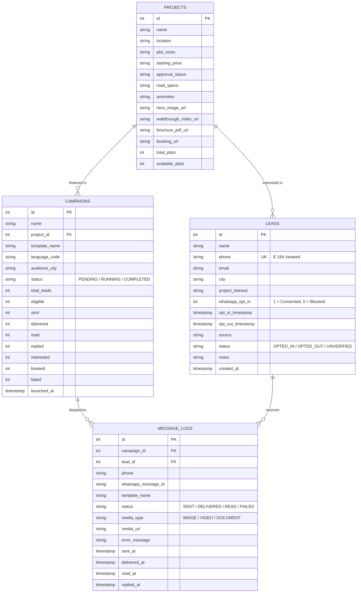
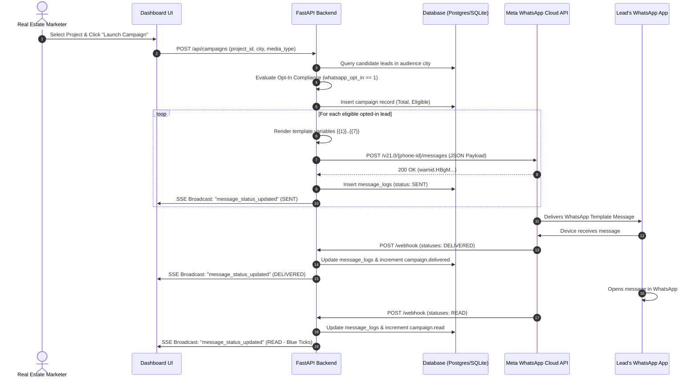
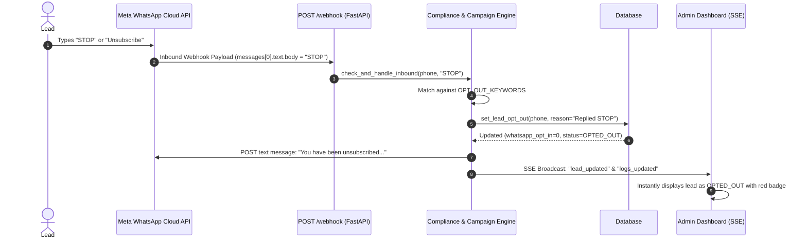

# 🏡 Knowledge Transfer (KT) Document
## Real Estate WhatsApp Marketing & Template Sending Platform
**Integrated with Meta WhatsApp Business Cloud API (v21.0)**

---

## 📌 Document Overview & Metadata

| Attribute | Details |
| :--- | :--- |
| **Project Title** | Real Estate WhatsApp Marketing & Template Sending System |
| **Target Audience** | Software Engineers, QA Engineers, DevOps, Solutions Architects, Product Managers |
| **Technology Stack** | Python 3.12, FastAPI, Meta WhatsApp Cloud API (v21.0), SQLite / PostgreSQL 16, Nginx, Vanilla JS / CSS3, SSE (Server-Sent Events) |
| **Version** | v2.0.0 Enterprise Edition |
| **Document Purpose** | Comprehensive Knowledge Transfer (KT) guide for onboarding, architecture understanding, operational maintenance, and delivering KT presentation sessions |

---

## 📑 Table of Contents

1. [Executive Summary & Business Context](#1-executive-summary--business-context)
2. [End-to-End System Architecture](#2-end-to-end-system-architecture)
3. [Core Subsystems & Module Breakdown](#3-core-subsystems--module-breakdown)
   - 3.1. Meta WhatsApp Cloud API Client (`whatsapp/client.py`)
   - 3.2. Marketing Template Generator (`marketing/template_generator.py`)
   - 3.3. Opt-In Compliance & Consent Engine (`marketing/compliance.py`)
   - 3.4. Campaign Execution & Throttling Engine (`marketing/campaign_engine.py`)
   - 3.5. Webhook Ingestion & Real-Time SSE Event Bus (`backend/routers/webhook.py`, `backend/events.py`)
   - 3.6. Dual-Mode Database Layer (`database.py`)
   - 3.7. Interactive Frontend & Live WhatsApp Simulator (`frontend/`)
   - 3.8. Headless CLI Tooling (`send_whatsapp.py`)
4. [Data Models & Schema Reference](#4-data-models--schema-reference)
5. [End-to-End Request & Event Lifecycles](#5-end-to-end-request--event-lifecycles)
   - 5.1. Campaign Dispatch & Delivery Lifecycle
   - 5.2. Inbound Webhook, Opt-Out (STOP), and Buyer Intent Routing
6. [API Endpoints & Webhook Specification](#6-api-endpoints--webhook-specification)
7. [Environment Configuration & Meta Setup](#7-environment-configuration--meta-setup)
8. [Deployment & Run Guide (Docker vs. Local)](#8-deployment--run-guide-docker-vs-local)
9. [Automated Testing & Quality Assurance](#9-automated-testing--quality-assurance)
10. [Presenter's KT Delivery Playbook & Demo Script](#10-presenters-kt-delivery-playbook--demo-script)
    - 10.1. 30-Minute KT Session Agenda
    - 10.2. Step-by-Step Live Demo Script
    - 10.3. Top 10 Audience FAQs & Answers

---

## 1. Executive Summary & Business Context

### 1.1 The Business Problem
In real estate marketing, layout and plotted-development platforms (e.g., land developments, villa plots, township launches) struggle with:
1. **Low Conversion via Cold Channels:** Traditional cold SMS and email suffer from less than 2% click-through rates and spam folder trapping.
2. **Meta Compliance Penalties:** Meta enforces strict policies on WhatsApp Business messaging. Sending unprompted marketing messages without recorded consent leads to immediate phone number quality downgrades, tier demotions, or account bans.
3. **Complex Plot Information Delivery:** Real estate buyers need high-resolution layout maps, DTCP/RERA approvals, pricing ranges, and walkthrough videos before talking to sales.
4. **Disjointed Lead Funnels:** Lack of real-time visibility into message delivery states (`sent` -> `delivered` -> `read` -> `replied`).

### 1.2 The Solution
This platform provides an automated, enterprise-grade marketing and lead-funnel system powered by the **Meta WhatsApp Business Cloud API**:
- **Strict Opt-In Compliance:** Validates explicit user consent (`whatsapp_opt_in = 1`, no opt-out timestamp) before any marketing template can be dispatched.
- **Automated Opt-Out (STOP) Handling:** Instantly detects unsubscribe keywords (`STOP`, `UNSUBSCRIBE`, `CANCEL`) in incoming webhooks, immediately revoking consent and updating CRM status to protect the sender's phone number health.
- **Rich Media Template Generation:** Generates Meta-approved JSON payloads with dynamic variables (`{{1}}` to `{{7}}`) for project location, plot sizes, starting price, and approvals, paired with Hero Images, MP4 Walkthroughs, or PDF Layout Maps.
- **Campaign Funnel Analytics:** Tracks the entire conversion pipeline in real time:
  $$\text{Total Leads} \longrightarrow \text{Opted-In} \longrightarrow \text{Sent} \longrightarrow \text{Delivered} \longrightarrow \text{Read} \longrightarrow \text{Replied} \longrightarrow \text{Interested} \longrightarrow \text{Booked}$$
- **Zero-Latency Live Sync:** Utilizes Server-Sent Events (SSE) to update connected admin dashboards and an interactive WhatsApp smartphone simulator in real-time as webhooks arrive.

---

## 2. End-to-End System Architecture

The solution is containerized via Docker Compose with three decoupled layers: **Frontend (Nginx)**, **Backend (FastAPI)**, and **Database (PostgreSQL / SQLite)**.

```
                              ┌──────────────────────────────────────────────┐
                              │           Meta Graph API (v21.0)             │
                              │       https://graph.facebook.com             │
                              └──────┬───────────────────────────────▲───────┘
                                     │                               │
                      Webhook Events │ (Statuses/Inbound)            │ Outbound Templates / Messages
                                     ▼                               │
┌────────────────────────────────────────────────────────────────────┴────────────────────────┐
│                                       DOCKER COMPOSE                                         │
│                                                                                              │
│   ┌──────────────────────────┐         ┌─────────────────────────────────────────────────┐   │
│   │         FRONTEND         │         │                     BACKEND                     │   │
│   │       Nginx Alpine       │         │              Python 3.12 + FastAPI              │   │
│   │        (Port 80)         │         │                   (Port 8000)                   │   │
│   │                          │         │                                                 │   │
│   │  • Static Web Assets     │         │  ┌───────────────────────┐  ┌────────────────┐  │   │
│   │    - index.html          │         │  │    FastAPI Routers    │  │   Event Bus    │  │   │
│   │    - styles.css (Glass)  │         │  │ (/api/leads,campaigns)│  │  (SSE Streaming│  │   │
│   │    - app.js (Live Sync)  │         │  └───────────┬───────────┘  └───────▲────────┘  │   │
│   │                          │         │              │                      │           │   │
│   │  • Nginx Reverse Proxy   │         │  ┌───────────▼───────────┐          │           │   │
│   │    - /api/*  ────────────┼────────►│  │   Campaign Engine     │          │ Broadcast │   │
│   │    - /webhook ───────────┼────────►│  │  & Compliance Engine  │──────────┤ Events    │   │
│   │    - SSE Streaming       │         │  └───────────┬───────────┘          │           │   │
│   │      (Buffering OFF)     │◄────────┼──────────────┴──────────────────────┘           │   │
│   └──────────────────────────┘  SSE    │              │                                  │   │
│                                        │  ┌───────────▼───────────┐                      │   │
│                                        │  │     database.py       │                      │   │
│                                        │  │ (SQLite / PostgreSQL) │                      │   │
│                                        │  └───────────┬───────────┘                      │   │
│                                        └──────────────┼──────────────────────────────────┘   │
│                                                       │                                      │
│                                        ┌──────────────▼──────────────────────────────────┐   │
│                                        │                  DATABASE                       │   │
│                                        │            PostgreSQL 16 Alpine                 │   │
│                                        │                 (Port 5432)                     │   │
│                                        │    leads | projects | campaigns | logs          │   │
│                                        └─────────────────────────────────────────────────┘   │
└──────────────────────────────────────────────────────────────────────────────────────────────┘
```

### Component Roles

| Service | Container Name | Base Image | Port | Description |
| :--- | :--- | :--- | :--- | :--- |
| **Frontend** | `whatsapp-frontend` | `nginx:alpine` | `80:80` | Serves dashboard UI, proxies `/api/` & `/webhook`, disables proxy buffering for long-lived SSE connections. |
| **Backend** | `whatsapp-backend` | `python:3.12-slim` | `8000:8000` | REST API, Webhook endpoint, Campaign dispatching, Opt-in verification, SSE broadcaster. |
| **Database** | `whatsapp-db` | `postgres:16-alpine` | `5432:5432` | Persistent storage with health check validation (`pg_isready`). |

---

## 3. Core Subsystems & Module Breakdown

### 3.1 Meta WhatsApp Cloud API Client (`whatsapp/client.py`)
- **Location:** [`whatsapp/client.py`](file:///d:/Work/internship%20assignment/whatsapp-chatbot/whatsapp/client.py)
- **Role:** Low-level HTTP transport client connecting to Meta Graph API `https://graph.facebook.com/v21.0/{phone_number_id}/messages`.
- **Key Responsibilities:**
  - **Phone Sanitization (`clean_phone_number`):** Cleans input strings (e.g. `+91-88257-81789` -> `918825781789`), stripping whitespace, hyphens, and `+` signs to satisfy E.164 requirements.
  - **Dynamic Environment Loading:** Uses property `@property headers` with dynamic reload from `.env` to avoid stale authorization tokens.
  - **Diagnostic Error Handling (`_handle_response`):** Parses Meta error payloads, providing actionable mitigation hints:
    - `Error 190`: Access token expired or invalid.
    - `Error 130429`: Meta Cloud API rate limit exceeded (tier throttling required).
    - `Error 132001`: Template does not exist or has not been approved in Meta WhatsApp Manager.
    - `Error 131026`: Receiver cannot receive message (user uninstalled WhatsApp or opted out).
  - **Mock / Fallback Execution:** Gracefully operates in mock mode for local offline development when credentials are dummy strings.

### 3.2 Marketing Template Generator (`marketing/template_generator.py`)
- **Location:** [`marketing/template_generator.py`](file:///d:/Work/internship%20assignment/whatsapp-chatbot/marketing/template_generator.py)
- **Role:** Assembles Meta-approved schema JSON payloads for the template `real_estate_launch_v1`.
- **Template Specification:**
  - **Header Component:** Dynamic text parameter (`{{1}}` = City, e.g., "Chennai") or media header (Image, Video, Document).
  - **Body Component (`{{1}}` to `{{7}}`):**
    - `{{1}}`: Lead Name (e.g. "Aravind Kumar")
    - `{{2}}`: Project Name (e.g. "Green Valley Emerald Layout")
    - `{{3}}`: Project Location (e.g. "Tambaram West, Chennai")
    - `{{4}}`: Plot Dimensions (e.g. "600–2400 sq.ft")
    - `{{5}}`: Starting Price (e.g. "₹28 Lakhs")
    - `{{6}}`: Approval Status (e.g. "DTCP & RERA Approved")
    - `{{7}}`: Road Specifications & Amenities (e.g. "30ft roads, Park, Water")
  - **Mandatory Footer:** Unsubscribe notice: `Reply STOP to unsubscribe • ABC Properties`.
  - **Interactive Action Buttons:**
    - Quick Reply 1: `View Layout Plan`
    - Quick Reply 2: `Book a Plot`
    - Quick Reply 3: `Talk to Sales`

### 3.3 Opt-In Compliance & Consent Engine (`marketing/compliance.py`)
- **Location:** [`marketing/compliance.py`](file:///d:/Work/internship%20assignment/whatsapp-chatbot/marketing/compliance.py)
- **Role:** Enforces Meta's Business Messaging Opt-In policies.
- **Compliance Rules:**
  1. **Strict Gatekeeping (`can_send_marketing_message`):**
     - Lead must exist.
     - `whatsapp_opt_in` flag must evaluate to `1` (True).
     - `opt_out_timestamp` must be `NULL`.
     - Status must not be `OPTED_OUT`, `UNVERIFIED`, or `BLOCKED`.
  2. **Automated STOP Opt-Out:**
     - Keyword triggers: `stop`, `unsubscribe`, `optout`, `opt-out`, `cancel`, `halt`, `revoke`.
     - On match: Automatically revokes consent in database, stamps `opt_out_timestamp`, sets status to `OPTED_OUT`, and generates a confirmation reply.
  3. **Re-Opt-In Support:**
     - Keyword triggers: `start`, `optin`, `subscribe`, `join`.
     - Reactivates lead status to `OPTED_IN` and stamps new `opt_in_timestamp`.
  4. **Intent Detection:**
     - Recognizes buyer intent keywords (`interested`, `book plot`, `view layout`, `price`) to advance campaign funnel stats.

### 3.4 Campaign Execution & Throttling Engine (`marketing/campaign_engine.py`)
- **Location:** [`marketing/campaign_engine.py`](file:///d:/Work/internship%20assignment/whatsapp-chatbot/marketing/campaign_engine.py)
- **Role:** Orchestrates multi-recipient campaign broadcasts.
- **Mechanics:**
  - **Pre-Flight Audience Segmentation (`prepare_campaign_audience`):** Splits candidate leads into `eligible_leads` and `ineligible_leads` with explanatory audit reasons.
  - **Rate Throttling:** Implements controlled sleep intervals (`throttle_seconds=0.2`) between API dispatches to adhere to Meta tier boundaries (e.g., 80 messages/second for Tier 1).
  - **Dry Run Capability:** Supports simulated runs (`dry_run=True`) to preview execution without making live outbound calls.
  - **State Updates:** Automatically increments campaign metrics (`total_leads`, `eligible`, `sent`, `failed`) and creates records in `message_logs`.

### 3.5 Webhook Ingestion & Real-Time SSE Event Bus (`backend/routers/webhook.py`, `backend/events.py`)
- **Location:** [`backend/routers/webhook.py`](file:///d:/Work/internship%20assignment/whatsapp-chatbot/backend/routers/webhook.py) & [`backend/events.py`](file:///d:/Work/internship%20assignment/whatsapp-chatbot/backend/events.py)
- **Role:** Asynchronous webhook handler and Server-Sent Events (SSE) broadcaster.
- **Features:**
  - `GET /webhook`: Verification handshake with Meta (`hub.mode`, `hub.verify_token`, `hub.challenge`).
  - `POST /webhook`: Ingestion point for delivery receipts (`statuses`) and inbound customer replies (`messages`).
  - **Thread-Safe SSE Event Bus:** Connected web clients subscribe to `/api/events`. When delivery callbacks arrive (e.g., message read or STOP replied), events are broadcast instantly to all open admin dashboards.

### 3.6 Dual-Mode Database Layer (`database.py`)
- **Location:** [`database.py`](file:///d:/Work/internship%20assignment/whatsapp-chatbot/database.py)
- **Role:** Unified persistence abstraction supporting SQLite for local zero-dependency testing and PostgreSQL for production.
- **Features:**
  - Automatic migration on startup (`init_db`).
  - Auto-seeding realistic demonstration data (`_seed_data_if_empty`): projects, pre-configured opted-in leads, opted-out leads, and demo campaign metrics.

### 3.7 Interactive Frontend & Live WhatsApp Simulator (`frontend/`)
- **Location:** [`frontend/index.html`](file:///d:/Work/internship%20assignment/whatsapp-chatbot/frontend/index.html), [`frontend/css/styles.css`](file:///d:/Work/internship%20assignment/whatsapp-chatbot/frontend/css/styles.css), [`frontend/js/app.js`](file:///d:/Work/internship%20assignment/whatsapp-chatbot/frontend/js/app.js)
- **Role:** Full-featured Admin Dashboard and Marketing Studio.
- **Features:**
  - **Pixel-Perfect WhatsApp Smartphone Simulator:** Renders real estate templates with dynamic Image/Video/PDF headers, highlighted plot specs, double blue ticks, and interactive reply buttons.
  - **KPI Funnel Ribbon:** Live statistics display with conversion rate pill badges.
  - **Campaign Launchpad:** City filters, media asset selection, dry-run toggles, and 1-click execution.
  - **Lead Consent Manager:** Search, add, edit, delete, and 1-click toggle opt-in/opt-out with audit timestamps.
  - **Delivery & Webhook Logs:** Real-time log table with status badges (`SENT`, `DELIVERED`, `READ`, `FAILED`).
  - **API Verification Modal:** 1-click credential diagnostics with Meta Cloud API.

### 3.8 Headless CLI Tooling (`send_whatsapp.py`)
- **Location:** [`send_whatsapp.py`](file:///d:/Work/internship%20assignment/whatsapp-chatbot/send_whatsapp.py)
- **Role:** Command-line companion for DevOps, batch jobs, and terminal-based testing.
- **Commands:**
  ```bash
  python send_whatsapp.py --verify
  python send_whatsapp.py --preview --project-id 1
  python send_whatsapp.py --to 919876543210 --project-id 1 --media IMAGE
  python send_whatsapp.py --campaign --city Chennai
  python send_whatsapp.py --opt-out 919876543210
  ```

---

## 4. Data Models & Schema Reference

The database consists of 4 relational tables:



---

## 5. End-to-End Request & Event Lifecycles

### 5.1 Campaign Dispatch & Delivery Lifecycle



### 5.2 Inbound Webhook, Opt-Out (STOP), and Buyer Intent Routing



---

## 6. API Endpoints & Webhook Specification

All backend endpoints are prefixed with `/api/` (except `/webhook` and `/health`):

| Method | Endpoint | Description | Request Body / Query Params |
| :--- | :--- | :--- | :--- |
| `GET` | `/health` | Service health check | None |
| `GET` | `/webhook` | Meta Webhook Handshake | `hub.mode`, `hub.verify_token`, `hub.challenge` |
| `POST` | `/webhook` | Inbound Webhook Event Ingestion | Meta standard webhook JSON payload |
| `GET` | `/api/stats` | Aggregate funnel statistics | None |
| `GET` | `/api/leads` | List leads with filter options | `opt_in` (bool), `city` (str), `search` (str) |
| `POST` | `/api/leads` | Create or update a lead | `CreateLeadRequest` (name, phone, opt-in, etc.) |
| `POST` | `/api/leads/toggle-opt-in` | 1-click toggle consent status | `ToggleOptInRequest` (phone, opt_in) |
| `DELETE`| `/api/leads/{id}` | Delete lead record | Path parameter `id` |
| `GET` | `/api/projects` | Fetch real estate catalog | None |
| `GET` | `/api/templates/preview`| Render preview & Meta JSON | `project_id`, `lead_name`, `media_type` |
| `GET` | `/api/campaigns` | List all campaigns & funnels | None |
| `POST` | `/api/campaigns` | Launch marketing broadcast | `LaunchCampaignRequest` (project_id, dry_run) |
| `GET` | `/api/whatsapp/verify` | Test Meta API credentials | None |
| `POST` | `/api/whatsapp/send` | Send template to single lead | `SendTestTemplateRequest` |
| `GET` | `/api/logs` | Fetch message delivery logs | `campaign_id`, `status`, `limit` |
| `GET` | `/api/events` | Server-Sent Events stream | Stream response (`text/event-stream`) |

---

## 7. Environment Configuration & Meta Setup

### 7.1 Environment Variables Reference (`.env`)

```ini
# =================================================================
# Meta WhatsApp Business Cloud API Configuration
# =================================================================
# Permanent or 24-hr System User Access Token from Meta Developer Portal
WHATSAPP_API_KEY=EAA...your_token_here

# Meta Assigned Phone Number ID (Under WhatsApp > API Setup)
PHONE_NUMBER_ID=109876543210987

# WhatsApp Business Account ID (WABA)
WHATSAPP_BUSSINESS_ACCOUNT_ID=101234567890123

# Graph API Version (defaults to v21.0)
WHATSAPP_API_VERSION=v21.0

# =================================================================
# Webhook Handshake Verification Token
# Must match the Verify Token entered in Meta App Dashboard
# =================================================================
WEBHOOK_VERIFY_TOKEN=whatsapp_realestate_verify_token_123

# =================================================================
# Database Configuration (PostgreSQL / SQLite)
# =================================================================
POSTGRES_USER=whatsapp_user
POSTGRES_PASSWORD=whatsapp_pass
POSTGRES_DB=whatsapp_marketing
SQLITE_DB_PATH=real_estate_marketing.db
```

### 7.2 Configuring Webhooks in Meta Developer Dashboard

1. **Expose Local Environment:**
   Run an HTTPS tunnel via ngrok:
   ```bash
   ngrok http 80
   ```
2. **Meta App Dashboard Setup:**
   - Navigate to **WhatsApp** -> **Configuration**.
   - Under **Webhook**, click **Edit**.
   - **Callback URL:** `https://<your-ngrok-subdomain>.ngrok-free.app/webhook`
   - **Verify Token:** Value of `WEBHOOK_VERIFY_TOKEN` (e.g. `whatsapp_realestate_verify_token_123`)
   - Click **Verify and Save**.
3. **Webhook Field Subscriptions:**
   - Click **Manage Webhook fields**.
   - Check the **`messages`** subscription box.

---

## 8. Deployment & Run Guide (Docker vs. Local)

### 8.1 Method 1: Production Multi-Container (Docker Compose)
This is the recommended deployment mode. It spins up Nginx, FastAPI, and PostgreSQL with automatic health checks.

```bash
# 1. Clone repository and navigate to folder
cd "d:\Work\internship assignment\whatsapp-chatbot"

# 2. Configure environment
cp .env.example .env
# Edit .env with your Meta credentials

# 3. Build and launch all containers
docker compose up --build -d

# 4. Check container health status
docker compose ps

# 5. Access the application
# Open http://localhost in any browser
```

### 8.2 Method 2: Local Developer Run (Direct Python)
Ideal for fast iterative development and debugging without Docker.

```bash
# 1. Install dependencies
pip install -r requirements.txt

# 2. Run the test suite to verify baseline functionality
python test_suite.py

# 3. Launch backend & embedded server
python webhook_server.py
# Server starts at http://localhost:8000
```

---

## 9. Automated Testing & Quality Assurance

The project contains a comprehensive automated test suite in [`test_suite.py`](file:///d:/Work/internship%20assignment/whatsapp-chatbot/test_suite.py).

### How to Run Tests
```bash
python test_suite.py
```

### Test Coverage Highlights

| Test Case | Module | What is Verified |
| :--- | :--- | :--- |
| `test_phone_number_cleaning` | `WhatsAppClient` | International phone normalization (removes `+`, spaces, hyphens). |
| `test_client_init` | `WhatsAppClient` | Correct endpoint construction (`/v21.0/{id}/messages`). |
| `test_rendered_preview_contains_specs`| `TemplateGenerator` | Template interpolation with layout name, location, price, and STOP footer. |
| `test_meta_template_payload_schema` | `TemplateGenerator` | Validates Meta Graph API JSON schema compliance. |
| `test_opted_in_lead_can_receive_message`| `ComplianceEngine` | Consented leads are permitted for marketing messages. |
| `test_opted_out_lead_is_blocked` | `ComplianceEngine` | Unsubscribed leads are strictly blocked. |
| `test_unverified_lead_is_blocked` | `ComplianceEngine` | Leads without explicit opt-in are rejected. |
| `test_stop_keyword_triggers_opt_out` | `ComplianceEngine` | Replying "STOP" updates database status to `OPTED_OUT`. |
| `test_start_keyword_triggers_opt_in` | `ComplianceEngine` | Replying "START" reactivates lead consent. |
| `test_campaign_audience_filtering` | `CampaignEngine` | Validates correct audience count split (eligible vs ineligible). |
| `test_webhook_verification_success` | Webhook API | Validates `hub.challenge` return when token matches. |
| `test_webhook_verification_failure` | Webhook API | Validates `403 Forbidden` on invalid token. |
| `test_webhook_status_update_flow` | Webhook API | Validates status updates (`delivered`, `read`) in `message_logs`. |
| `test_webhook_inbound_stop_flow` | Webhook API | End-to-end inbound STOP processing via webhook endpoint. |

---

## 10. Presenter's KT Delivery Playbook & Demo Script

Use this section as your exact speaking notes, timing agenda, and presentation blueprint when delivering the KT session.

### 10.1 30-Minute KT Session Agenda

```
┌────────────────────────────────────────────────────────────────────────┐
│                        30-MINUTE KT AGENDA                             │
│                                                                        │
│  [00:00 - 05:00]  1. Problem Context & Meta Compliance Mandate        │
│  [05:00 - 12:00]  2. Architecture & Container Ecosystem (Nginx/API/DB) │
│  [12:00 - 20:00]  3. Live End-to-End System Demonstration             │
│  [20:00 - 25:00]  4. Code Walkthrough (Compliance, Generator, Webhook) │
│  [25:00 - 30:00]  5. Q&A and Developer Onboarding Checklist           │
└────────────────────────────────────────────────────────────────────────┘
```

---

### 10.2 Step-by-Step Live Demo Script

#### Step 1: Open Dashboard & Show System Health (1 minute)
- Open your browser to `http://localhost`.
- **Explain:** Point out the top header status pills:
  - **Live SSE Sync:** Green pulse indicating persistent Server-Sent Events connection.
  - **Meta API Status:** Displays active connection to Meta Cloud API (or mock mode badge).
  - Click **⚡ Verify API** to show live token verification.

#### Step 2: Showcase the Smartphone Simulator & Template Studio (3 minutes)
- Navigate to the **📱 Smartphone Simulator & Studio** tab.
- **Explain:** This simulator mirrors what real estate buyers see on their WhatsApp app.
- Change the **Project Selector** dropdown (e.g., from *Green Valley Emerald* to *Sunrise Palm Meadows*). Notice the template variables change dynamically.
- Toggle between **🖼️ Hero Image**, **🎬 Walkthrough Video**, and **📑 Layout Plan PDF**.
- Show the **Copy JSON** button: Explain that this is the exact payload sent to `https://graph.facebook.com/v21.0/{phone-id}/messages`.

#### Step 3: Demonstrate Opt-In Compliance & Consent Guardrails (2 minutes)
- Switch to the **👥 Lead Consent Manager** tab.
- Show the lead records:
  - Point out opted-in leads with green badges.
  - Point out opted-out leads with red `OPTED_OUT` badges and audit timestamps.
- Click the **Consent Switch** on any lead to toggle consent on/off.
- Click **➕ Add Lead** and enter a lead without checking the opt-in box.
- Explain: *"Notice how our backend marks this lead as `UNVERIFIED`. The campaign engine will refuse to send marketing messages to this user, preventing policy violations."*

#### Step 4: Launch a Campaign & Observe Real-Time Funnel (2 minutes)
- Switch to the **🚀 Campaign Launchpad** tab.
- Select a Project and target city.
- Point out the **Audience Breakdown Card**:
  - Highlights *Total Pool*, *Eligible Opted-In*, and *Ineligible Blocked*.
- Click **🚀 Launch WhatsApp Campaign**.
- Watch the progress bar advance and metrics update live via SSE without any page refreshes!
- Switch to **📊 Message & Webhook Logs** to view each dispatched message and its unique WhatsApp message ID (`wamid`).

#### Step 5: Simulate Inbound Customer Interaction & Automated STOP Opt-Out (2 minutes)
- Open the CLI companion or send a test webhook:
  - Trigger a reply with `"STOP"`.
  - Notice the lead's status instantly switches to `OPTED_OUT` on the dashboard in real-time.
  - Trigger a reply with `"Book a Plot"`.
  - Notice the **Booked Plots** counter increment on the analytics ribbon!

---

### 10.3 Top 10 Audience FAQs & Answers

#### Q1: Why do we use Meta WhatsApp Cloud API instead of unofficial Web scraping / Baileys / Puppeteer libraries?
> **Answer:** Unofficial libraries violate Meta's Terms of Service and result in permanent phone number bans within days. The official Meta WhatsApp Cloud API provides 99.9% uptime, official business account badges, high throughput (up to 1,000 messages/sec), and compliant webhook status callbacks.

#### Q2: How does the system prevent sending messages to people who haven't opted in?
> **Answer:** Before every single message dispatch, [`ComplianceEngine.can_send_marketing_message()`](file:///d:/Work/internship%20assignment/whatsapp-chatbot/marketing/compliance.py) checks three rules: `whatsapp_opt_in == 1`, `opt_out_timestamp is NULL`, and `status != 'OPTED_OUT'`. If any check fails, the message is blocked before touching the Meta API.

#### Q3: What happens when a user replies "STOP"?
> **Answer:** Meta delivers an inbound message webhook to `/webhook`. The `ComplianceEngine` checks the text against `OPT_OUT_KEYWORDS`. It immediately marks the lead's `whatsapp_opt_in = 0`, sets `opt_out_timestamp = current_timestamp`, and updates the status to `OPTED_OUT`. An automated confirmation message is returned to the user, and an SSE event updates the UI immediately.

#### Q4: Why is Server-Sent Events (SSE) used instead of WebSockets?
> **Answer:** The dashboard only needs unidirectional real-time updates from server to client (webhook callbacks and status updates). SSE is simpler, operates over standard HTTP/1.1 or HTTP/2, automatically reconnects upon disconnection, and doesn't require maintaining complex two-way WebSocket states.

#### Q5: How do we handle Meta rate limiting?
> **Answer:** The [`CampaignEngine`](file:///d:/Work/internship%20assignment/whatsapp-chatbot/marketing/campaign_engine.py) implements configurable per-message throttling (`throttle_seconds=0.2`). In addition, the `WhatsAppClient` inspects error code `130429` (rate limit hit) and supports exponential backoff.

#### Q6: How does the dual-database setup work?
> **Answer:** In [`database.py`](file:///d:/Work/internship%20assignment/whatsapp-chatbot/database.py), if `DATABASE_URL` is set (as in the Docker container), it connects to PostgreSQL. Otherwise, it falls back to an embedded SQLite database (`real_estate_marketing.db`). Both use the identical schema and auto-seed sample records on boot.

#### Q7: Can we send marketing messages outside the 24-hour customer service window?
> **Answer:** Yes, but **only via pre-approved Meta Message Templates** (like `real_estate_launch_v1`). Non-template session messages can only be sent within 24 hours of a user's inbound message.

#### Q8: How are real estate media assets (images, walkthrough videos, layout PDFs) delivered?
> **Answer:** In Meta's template architecture, media headers accept hosted HTTPS URLs (e.g. AWS S3, Cloudinary, or public CDNs). The template generator injects the media URL into the template header component (`{"type": "image", "image": {"link": url}}`). Meta's servers download and cache the media for delivery.

#### Q9: How do we test webhooks locally during development?
> **Answer:** By using an HTTPS tunnel such as `ngrok http 80`. We supply the ngrok HTTPS URL in the Meta Developer Dashboard under the Webhook Configuration tab along with our `WEBHOOK_VERIFY_TOKEN`.

#### Q10: How do we register a new template with Meta?
> **Answer:** Templates are registered in the **Meta WhatsApp Manager** under **Message Templates**. Once Meta approves the template (usually takes 1-15 minutes), the template name and language code (`en_US`) are plugged into [`template_generator.py`](file:///d:/Work/internship%20assignment/whatsapp-chatbot/marketing/template_generator.py).

---

## 🏁 Summary Checklist for the Next Developer

- [ ] Ensure `.env` is configured with valid Meta credentials.
- [ ] Run `python test_suite.py` to ensure all 16 tests pass.
- [ ] Spin up Docker using `docker compose up --build -d`.
- [ ] Open `http://localhost` and inspect the Smartphone Simulator.
- [ ] Verify webhook receipt by exposing port 80 via `ngrok http 80`.
